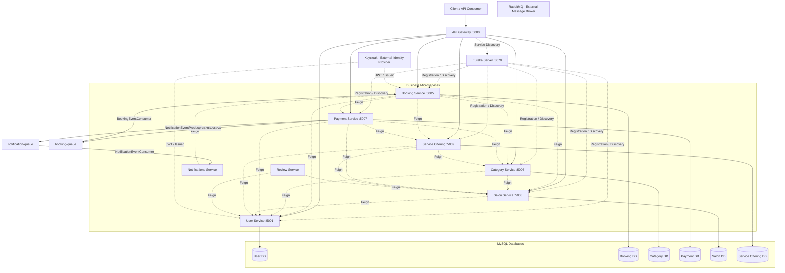

# Salon Booking Microservices

A microservices-based salon booking application developed using Java and Spring Boot. The project is designed to manage salon operations, service offerings, customer bookings, payments, and user authentication through independently organized services.

## Technology Stack

- **Language:** Java
- **Backend:** Spring Boot, Spring Cloud
- **Service Discovery:** Netflix Eureka
- **API Gateway:** Spring Cloud Gateway
- **Inter-service Communication:** OpenFeign
- **Authentication and Authorization:** Spring Security, Keycloak, JWT
- **Messaging:** RabbitMQ
- **Databases:** MySQL
- **Containerization:** Docker, Docker Compose
- **Build Tool:** Maven

## Architecture

The application follows a microservices architecture in which business capabilities are separated into individual services.



*The diagram represents the intended application integrations. Keycloak and RabbitMQ require separate infrastructure setup; they are not services defined in the current Docker Compose file.*

## Microservices

| Service | Port | Responsibility |
|---|---:|---|
| User Service | 5001 | User management and authentication integration |
| Booking Service | 5005 | Salon booking operations |
| Category Service | 5006 | Salon service categories |
| Payment Service | 5007 | Payment processing |
| Salon Service | 5008 | Salon management |
| Service Offering | 5009 | Salon service offerings |
| Notifications | Separate configuration | Notification-related functionality |
| Review | Separate configuration | Review-related functionality |
| Eureka Server | 8070 | Service discovery |
| API Gateway | 5000 | Centralized API routing |

## Key Features and Integrations

### 1. Microservices Architecture
- Business functionality is organized into independent services.
- Each primary business service has its own MySQL database.
- Services register with the Eureka discovery server.

### 2. API Gateway and Service Discovery
- Spring Cloud Gateway provides a centralized entry point.
- Eureka supports service registration and discovery.

### 3. Authentication and Authorization
- Spring Security is used for application security.
- Keycloak provides identity and access management integration.
- JWT tokens are used for securing protected APIs.
- Application roles include CUSTOMER, SALON_OWNER, and ADMIN.

### 4. Inter-service Communication
- OpenFeign is used for declarative service-to-service HTTP communication.
- RabbitMQ configuration is present in the booking, payment, and notifications services for messaging integration.

### 5. Database Management
- MySQL is used for persistent storage.
- Separate database containers are configured for the primary business services.

## Project Structure

```text
Salon-Booking-Microservices/
|
|-- user-service/
|-- booking-service/
|-- category-service/
|-- payment-service/
|-- salon-service/
|-- service_offering/
|-- notifications/
|-- review/
|
|-- eureka-server/
|-- gateway-server/
|
|-- docker-compose/
|   |-- default/
|       |-- docker-compose.yml
|
|-- README.md
```

## Getting Started

### Prerequisites

Install the following before running the application:

- Java JDK compatible with the project configuration
- Maven
- Docker Desktop
- Docker Compose
- MySQL (if running services outside Docker)
- Keycloak
- RabbitMQ

### Configuration

Application configuration uses environment variables for database, messaging, payment, and identity-provider settings.

Configure the required environment variables before starting the services.

Examples of configuration variable names:

```text
DB_USERNAME
DB_PASSWORD
PAYMENT_DB_URL

RABBITMQ_HOST
RABBITMQ_PORT
RABBITMQ_USERNAME
RABBITMQ_PASSWORD

KEYCLOAK_ISSUER_URI
KEYCLOAK_BASE_URL
KEYCLOAK_REALM
KEYCLOAK_CLIENT_ID

RAZORPAY_API_KEY
RAZORPAY_API_SECRET
STRIPE_API_KEY
```

Use your own local values. Never commit passwords, API keys, client secrets, or production credentials to GitHub.

Refer to the individual service application.yml files for the exact configuration required by each service.

### Start Docker Compose Services

From the project root, run:

```bash
docker compose -f docker-compose/default/docker-compose.yml config
```

To start the configured containers:

```bash
docker compose -f docker-compose/default/docker-compose.yml up -d
```

To check container status:

```bash
docker compose -f docker-compose/default/docker-compose.yml ps
```

To view logs:

```bash
docker compose -f docker-compose/default/docker-compose.yml logs -f
```

To stop the containers:

```bash
docker compose -f docker-compose/default/docker-compose.yml down
```

### Important Deployment Notes

The current Docker Compose configuration defines the following:

- Eureka Server
- API Gateway
- User, Booking, Category, Payment, Salon, and Service Offering services
- Five MySQL database containers

Keycloak and RabbitMQ are not defined as services in this Compose configuration. They must be configured and made reachable separately.

In particular, the Booking Service Compose configuration references RabbitMQ using the hostname `salon-rabbitmq`. Ensure that this hostname resolves from the Booking Service container before expecting messaging functionality to work.

The Notifications and Review modules are present in the repository but are not included in the current Compose service list.

## API Documentation

The application services can expose API documentation through Swagger UI when the corresponding Springdoc configuration is enabled.

Typical Springdoc endpoints are:

```text
/swagger-ui/index.html
/v3/api-docs
```

Check the individual service configuration and application startup logs for the actual documentation URL and availability.

## Testing

Unit tests have been executed for selected business services.

| Service | Test Result |
|---|---:|
| Booking Service | 28 tests passed |
| Payment Service | 6 tests passed |

These results cover the reported service-level unit tests.

## Future Improvements

- Improve centralized logging and monitoring.
- Complete automated container orchestration for external dependencies.
- Add comprehensive API documentation.
- Expand automated test coverage.
- Add CI/CD pipeline integration.

## Author

**Bhagyashree Atre**

Java | Spring Boot | Microservices | Spring Cloud

[GitHub Profile](https://github.com/BhagyashreeAtre)

## API Reference

The following endpoints are derived from the Spring MVC controller mappings in the respective services. They describe the implemented controller mappings; they have not all been independently verified through end-to-end API testing.

### 1. User Service

Base path: `/api/users`
Authentication endpoints use `/auth`.

| Method | Endpoint | Description | Request |
|---|---|---|---|
| POST | `/auth/signup` | Register a user | `SignupDTO` body |
| POST | `/auth/login` | Authenticate a user | `LoginDTO` body |
| GET | `/auth/access-token/refresh-token/{refreshToken}` | Generate access token from refresh token | Path variable |
| POST | `/api/users` | Create user | `User` body; ADMIN |
| GET | `/api/users/profile` | Get authenticated user's profile | JWT principal |
| GET | `/api/users` | List users | ADMIN |
| GET | `/api/users/{id}` | Get user by ID | ADMIN |
| PUT | `/api/users/{id}` | Update user | `User` body; ADMIN |
| DELETE | `/api/users/{id}` | Delete user | ADMIN |

### 2. Salon Service

Base path: `/api/salons`

| Method | Endpoint | Description | Request |
|---|---|---|---|
| POST | `/api/salons` | Create salon | `SalonDTO` body; Authorization header |
| PATCH | `/api/salons/{salonId}` | Update salon | Path variable, `SalonDTO` body; Authorization header |
| GET | `/api/salons` | List salons | — |
| GET | `/api/salons/{salonId}` | Get salon by ID | Path variable |
| GET | `/api/salons/search?city={city}` | Search salons by city | `city` query parameter |
| GET | `/api/salons/owner` | Get salon belonging to authenticated owner | Authorization header |

### 3. Category Service

Base path: `/api/categories`

| Method | Endpoint | Description | Request |
|---|---|---|---|
| GET | `/api/categories/salon/{id}` | Get categories for a salon | Salon ID |
| GET | `/api/categories/{id}` | Get category by ID | Category ID |
| POST | `/api/categories/salon-owner` | Create category for salon owner | `Category` body; Authorization header |
| DELETE | `/api/categories/salon-owner/{id}` | Delete category | Category ID; Authorization header |
| GET | `/api/categories/salon-owner/salon/{salonId}/category/{id}` | Find category by category ID and salon ID | Path variables |

**Note:** The category lookup endpoint uses both the salon ID and category ID as path variables.

### 4. Service Offering

Base path: `/api/service_offering`

| Method | Endpoint | Description | Request |
|---|---|---|---|
| GET | `/api/service_offering/salon/{salonId}` | Get services offered by a salon | Optional `categoryId` query parameter |
| GET | `/api/service_offering/{id}` | Get service offering by ID | Path variable |
| GET | `/api/service_offering/list/{ids}` | Get multiple service offerings by IDs | Set of IDs in path |
| POST | `/api/service_offering/salon_owner` | Create service offering | `ServiceDTO` body; Authorization header |
| PUT | `/api/service_offering/salon_owner/{id}` | Update service offering | ID path variable, `ServiceOffering` body |

### 5. Booking Service

Base path: `/api/bookings`

| Method | Endpoint | Description | Request |
|---|---|---|---|
| POST | `/api/bookings` | Create booking | `salonId`, `paymentMethod` query parameters; `BookingRequest` body; Authorization header |
| GET | `/api/bookings/customer` | Get bookings for authenticated customer | Authorization header |
| GET | `/api/bookings/salon` | Get bookings for authenticated salon owner | Authorization header |
| GET | `/api/bookings/{bookingId}` | Get booking by ID | Booking ID |
| PUT | `/api/bookings/{bookingId}/status` | Update booking status | Booking ID; `status` query parameter |
| GET | `/api/bookings/slots/salon/{salonId}/date/{date}` | Get booked slots for a salon and date | Salon ID and date |
| GET | `/api/bookings/report` | Get salon booking report | Authorization header |

### 6. Payment Service

Base path: `/api/payments`

| Method | Endpoint | Description | Request |
|---|---|---|---|
| POST | `/api/payments/create` | Create payment link | `BookingDTO` body; `paymentMethod` query parameter; Authorization header |
| GET | `/api/payments/{paymentOrderId}` | Get payment order | Payment order ID |
| PATCH | `/api/payments/proceed` | Proceed with payment confirmation | `paymentId` and `paymentLinkId` query parameters |

### 7. Notification Service

Base path: `/api/notifications`

| Method | Endpoint | Description | Request |
|---|---|---|---|
| POST | `/api/notifications` | Create notification | `Notification` body |
| GET | `/api/notifications/user/{userId}` | Get notifications for a user | User ID |
| PUT | `/api/notifications/{notificationId}/read` | Mark notification as read | Notification ID |
| GET | `/api/notifications/salon-owner/salon/{salonId}` | Retrieve notifications using the supplied salon ID; verify the underlying user-ID lookup semantics | Salon ID |

### 8. Review Service

Base path: `/api/reviews`

| Method | Endpoint | Description | Request |
|---|---|---|---|
| POST | `/api/reviews/salon/{salonId}` | Create review for a salon | `ReviewRequest` body; Authorization header |
| GET | `/api/reviews/salon/{salonId}` | Get reviews for a salon | Salon ID; Authorization header |
| PUT | `/api/reviews/{reviewId}` | Update review | Review ID, `ReviewRequest` body; Authorization header |
| DELETE | `/api/reviews/{reviewId}` | Delete review | Review ID; Authorization header |

### API Documentation Notes

- Request DTOs and entity types are listed as declared by the controller methods.
- `Authorization` headers are explicitly required by the controller signatures where indicated.
- The User Service uses `@PreAuthorize("hasRole('ADMIN')")` on the documented administrative endpoints.
- Other authentication and authorization rules may also be enforced through Spring Security configuration.
- Query parameters and path variables should be supplied using the types expected by the corresponding controller methods.
- These endpoint mappings do not by themselves establish that every API has passed runtime or integration testing.
